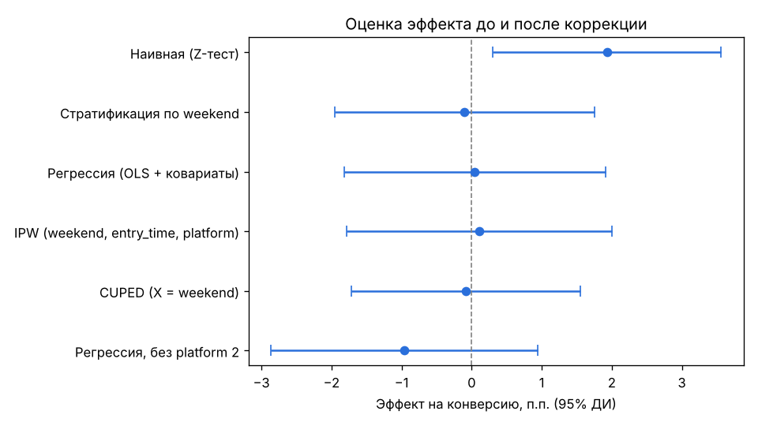
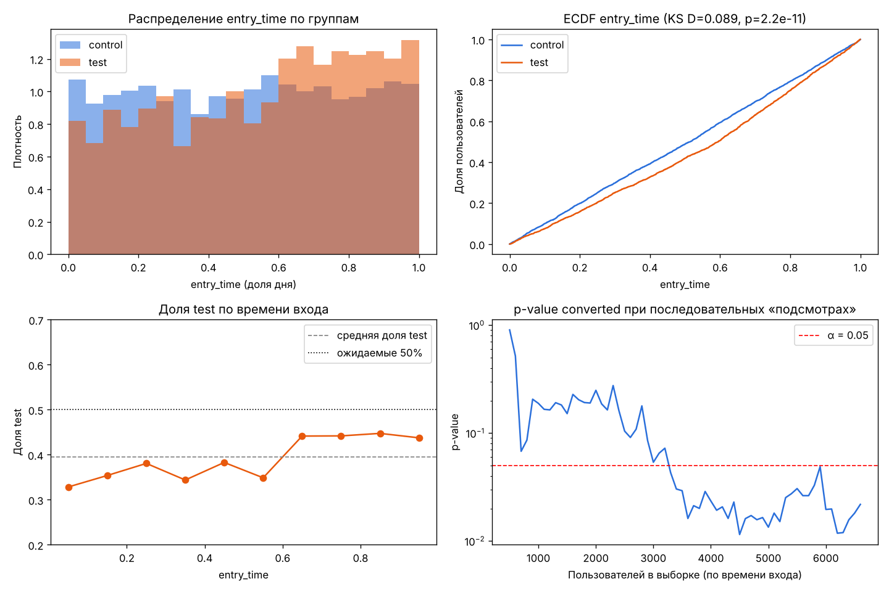

# AB-DZ-2 — аудит A/B-теста

МИФИ, домашнее задание №2. Есть датасет эксперимента и подозрение, что аналитик нарушил протокол.
Задача — провести полный аудит теста, найти скрытые проблемы, заложенные в данные, и решить, стоит ли внедрять фичу.

**Итог: фичу не запускаем, эксперимент нужно повторить с изменениями.**
Guardrail нарушен (ошибки выросли в 3.1 раза), а наивный рост конверсии +1.93 п.п. после поправки на confounder исчезает.

## Структура репозитория

| Файл | Что внутри |
|---|---|
| `data_generation/generate_data_original.py` | Исходный код генерации данных из задания (без изменений) |
| `data_generation/generate_data.py` | Рабочий генератор, которым создан датасет (изменения описаны ниже) |
| `exp_data_seed_4843151.csv` | Сгенерированные данные, **MY_SEED = 4843151**, 6626 пользователей |
| `ab_audit.ipynb` | Основное решение: исполненный ноутбук с кодом, выводами и графиками |
| `ab_audit.py` | Тот же анализ в виде Python-скрипта (ячейки `# %%`) |
| `figures/` | Графики: peeking, эффект по сегментам, оценки до и после коррекции |
| `requirements.txt` | Зависимости |

## Данные

Колонки: `user_id`, `variant` (control / test), `converted` (1/0), `error_flag` (1/0, guardrail),
`weekend` (1/0), `platform` (0, 1, 2), `entry_time` (время входа как доля дня, float;
в анализе переводится через `pd.to_timedelta(..., unit='D')`).

### Изменения в генераторе

Задание разрешает менять параметры рандомизации. Отличия `generate_data.py` от исходника:

1. **Peeking.** В исходном коде `variant` дважды перезаписывается, поэтому в итоге `entry_time` никак не связано с группой,
   и заложенное нарушение «в тесте более поздние пользователи» в данных не появляется.
   В рабочей версии после финального распределения по группам случайная доля test-пользователей (15–30%, зависит от seed)
   получает позднее время входа из интервала [0.6, 1).
2. Seed можно передать аргументом, чтобы файл можно было воспроизвести.
3. Файл сохраняется в корень репозитория, и печатается реальный путь (в исходнике печатался несуществующий `exp_data/`).

Остальная логика (SRM, confounder `weekend`, ложный сигнал на `platform = 2`, завышенный `error_flag` в test) не менялась.

Воспроизвести датасет:

```bash
python data_generation/generate_data.py 4843151
```

## Запуск

```bash
pip install -r requirements.txt
```

```bash
jupyter notebook ab_audit.ipynb
```

Или скриптом (графики сохранятся в `figures/`):

```bash
python ab_audit.py
```

## Результаты аудита

| # | Проверка | Результат | Вердикт |
|---|---|---|---|
| 1 | Размеры групп | control 4013 (60.6%), test 2613 (39.4%) | — |
| 2 | **SRM**, хи-квадрат против 50/50 | chi2 = 295.8, p = 2.7e-66 | **SRM обнаружен** |
| 2 | Баланс `weekend` (t-тест, хи-квадрат) | 12.3% в control против 57.7% в test, SMD = 1.08, p ≈ 0 | **Confounder** (weekend повышает конверсию: 15.2% против 10.8%) |
| 2 | Баланс `entry_time` (t-тест, U-тест) | среднее 0.504 против 0.551, p < 1e-9 | Дисбаланс |
| 3 | Первичная метрика `converted`, Z-тест | 11.39% → 13.32%, lift +1.93 п.п. (+16.9%), 95% ДИ [+0.30; +3.56], p = 0.019 | Смещённая оценка |
| 4 | **Guardrail** `error_flag` | 1.92% → 5.97% (в 3.1 раза), p = 1e-18; рост в обеих стратах weekend | **Нарушен → стоп** |
| 4 | Сегменты `platform` + Бонферрони / FDR | p0: +1.28 п.п. (p_adj = 0.61); p1: +0.94 п.п. (p_adj = 1.0); **p2: +9.80 п.п. (p_adj = 0.0055)** | Значим только маленький сегмент platform 2 (9% выборки) |
| 4 | **Peeking** (`entry_time` × variant) | доля test растёт с ≈35% до ≈44% в последних 40% времени; KS p = 2.2e-11, logit p = 1.7e-10 | **Признаки подглядывания** |

### Коррекция эффекта

| Метод | Эффект, п.п. | 95% ДИ | p-value |
|---|---|---|---|
| Наивный Z-тест | +1.93 | [+0.30; +3.56] | 0.019 |
| Стратификация по weekend | −0.10 | [−1.95; +1.75] | 0.91 |
| Регрессия (weekend, entry_time, platform) | +0.05 | [−1.82; +1.91] | 0.96 |
| IPW (propensity по weekend, entry_time, platform) | +0.11 | [−1.79; +2.00] | 0.91 |
| CUPED (X = weekend) | −0.08 | [−1.71; +1.55] | 0.92 |
| Регрессия без platform 2 | −0.96 | [−2.86; +0.94] | 0.32 |

После учёта weekend эффект на конверсию становится нулевым. SRM, подглядывание и нарушенный guardrail
статистической коррекцией не исправить, поэтому эксперимент признаётся невалидным.




## Финальное решение

**Не rollout → повторить с изменениями:**

* исправить причину ошибок загрузки в тестовой версии и проверить это на канареечном релизе;
* исправить сплит: хэширование `user_id` 50/50, ежедневный SRM-мониторинг;
* заранее зафиксировать MDE и размер выборки (для +1 п.п. от базы 11.4% нужно ≈ 16 440 пользователей на группу)
  и длительность — полные недели;
* не подглядывать в p-value или использовать последовательный дизайн (O'Brien–Fleming, mSPRT);
* проверить гипотезу про platform 2 отдельным, заранее заявленным тестом.
